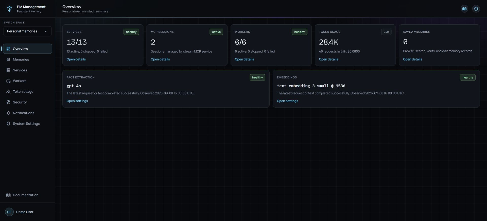

# Overview

## Purpose

Overview is the fastest way to decide where attention is needed. It summarizes the local services, active MCP sessions, worker schedules, recent token usage, saved memories, fact-extraction model, and embedding pin.

## Read the page

The default layout starts with clickable summary cards. A large value gives the count or total; the smaller line explains the period or state; the badge gives the health category.

| Card | How to read it |
| --- | --- |
| Services | Active services out of all detected services, plus stopped and failed counts |
| MCP sessions | Active sessions currently managed by the Stream MCP service |
| Workers | Enabled schedules out of all managed jobs, plus stopped and failed counts |
| Token usage | Tokens, requests, and estimated cost from the last 24 hours |
| Saved Memories | Number of personal memory records |
| Fact extraction | Current shape-gate provider and model |
| Embeddings | Current embedding model, vector dimension, mode, and vector name |

Overview refreshes automatically, so there is no manual refresh control.

## Arrange your Overview

Every summary, model, and lower panel can move anywhere among the other cards.
The defaults show three summary cards per row, then two equal model cards, then
**Live MCP activity** and **Corpus shape** in equal halves when their minimum widths fit.
Narrower views use fewer columns. Wide content scrolls inside its card rather than
making the whole page wider.

- Press and hold a card for one second to activate dragging. The selected card
  follows your pointer, and the other positions become faint empty placeholders.
  Release in an empty grid position or over another card to move it. Dropping over
  another card rearranges those positions. A quick click keeps its normal action;
  buttons and links inside panels remain available.
- Move the pointer close to either side border to highlight that edge and
  reveal its resize handle at the middle. Drag horizontally to snap between
  twelve equal row sections, including exact halves and thirds. The space between
  cards is included, so two half-width cards fit evenly on the same row when their
  minimum widths allow it. Existing saved widths snap to the nearest allowed size.
  Each edge moves independently: the opposite edge stays anchored, and other cards
  keep their size and position. Shrinking leaves empty grid cells. Growing stops at
  an occupied cell or the row boundary; resizing never moves a card to another row.
  Drag a card separately to move it into a gap or another row. The handle stays at
  the middle of the actual card edge, and the resize cursor stays active throughout
  the gesture. Release to save, or press **Escape** to restore the previous layout.
  With that handle focused, **Left** and **Right** move the grabbed edge one snap
  step, **Home** selects its minimum width, and **End** grows into available space.
  **Escape** cancels a drag or resize in progress. Card links, session controls,
  and text selection remain available inside the card.
- With the card itself focused, **Alt + arrow keys** move it between grid cells;
  **Alt + Home** moves it first and **Alt + End** moves it last.
- Select **Restore defaults** to reset positions and widths.

Completed changes save automatically in this browser profile for your current
personal identity. They survive page reloads, stack restarts, and reboots when you
return using the same browser profile and address. Layouts do not transfer between
devices or browser profiles. Clearing site data removes them. A storage warning
means the current change could not be saved; an unreadable or unsupported layout
shows defaults without overwriting the saved value until you change or reset it.

Saved positions and widths adapt to available space without replacing your preference.
Older saved widths migrate to grid positions when you next make a change; the older
record remains untouched as a fallback. Below a
card's minimum width, it fills the available row and its wide content scrolls internally.

## Memory activity indicators

The top panel shows **memory read**, **memory write** and **memory update**
immediately after **stream mcp**. Each uses the same small dot: it blinks for
activity and stays still when inactive. Labels, text and borders stay unchanged.
A short request that finishes between samples produces one brief flash.

The indicators observe authenticated requests for your personal identity, about
once per second while the page is visible. They show no memory content or results.
Read the operation's response to learn whether it succeeded.

## Live MCP activity

The lower row shows what is connected right now and where memory is accumulating.

Live MCP activity lists the stream sessions the MCP service is holding at this moment.

| Column | How to read it |
| --- | --- |
| Client | The connected agent application, with its session identifier below |
| Connection | The transport the session uses, normally streamable-http |
| Last seen | How long ago the MCP service last heard from that session |
| Terminates at | Time left before an idle session closes, and the clock time it closes |

Select a session to read its live communication inside the same card, then select **All sessions** to return to the list. A session leaves the list as soon as its connection closes, and the card returns to the list if the session you are watching disconnects. An agent that stops without closing its session stays listed until its idle timeout, which you set in System Settings.

Corpus shape, beside it, ranks the categories your saved memories fall into.

## Actions

1. Select any **Open details** link to open its exact destination.
2. Use the MCP card to open the **MCP sessions** tab in Services, not the application-service list.
3. Use **Open settings** on Fact extraction or Embeddings to open that exact System Settings section.
4. Select a session in **Live MCP activity** to watch its requests, and **All sessions** to go back.
5. Investigate error or attention badges before making unrelated configuration changes.

## States

| Badge or value | Meaning |
| --- | --- |
| health | All detected services are active. |
| attention | At least one service or schedule is stopped, or no rows were detected. |
| error | A service failed, Docker control is unavailable, a worker failed, or worker liveness is lost. |
| active | One or more Stream MCP sessions are connected. |
| no active sessions | The Stream MCP service is not reporting a connected client. |
| 24h | The token card is a fixed last-24-hours summary. |

## Cautions

> **Caution**
>
> Overview is a summary, not a control panel. Open the linked page and read its detailed state before stopping services, changing schedules, or editing settings.

The model and usage values may reveal operational metadata. Share screenshots only after checking them for sensitive data.

## Troubleshooting

| Problem | What to do |
| --- | --- |
| Services shows Unavailable | Open Services. The Docker control sidecar or its connection may be unavailable. |
| MCP session count is zero | Open **MCP sessions** and confirm the client is connected and has not reached its idle timeout. |
| Worker count shows an error | Open Workers and inspect the failed row's last-run log. |
| A count changed but Overview did not | Wait for automatic refresh, or leave and reopen Overview. |
| Live MCP activity shows no sessions | No agent is connected. Start Claude or Codex, or confirm the stream MCP registration in Services. |
| Live sessions are unavailable | The Docker control sidecar is not answering. Open Services and read its notice. |
| A session shows no output yet | The session has not sent a request since it connected. Its output appears with the next call. |
